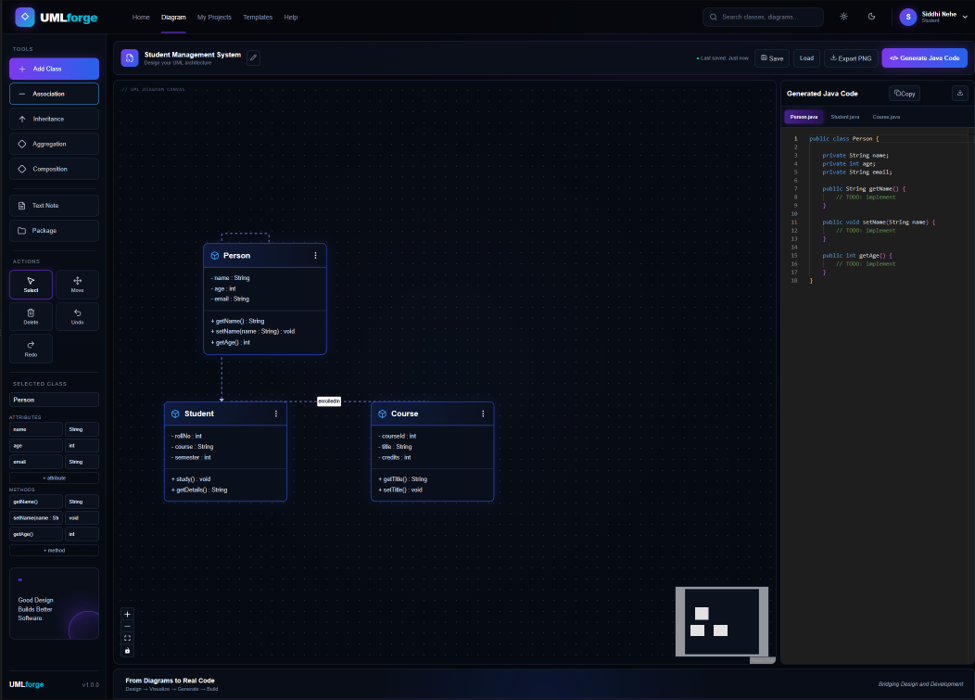
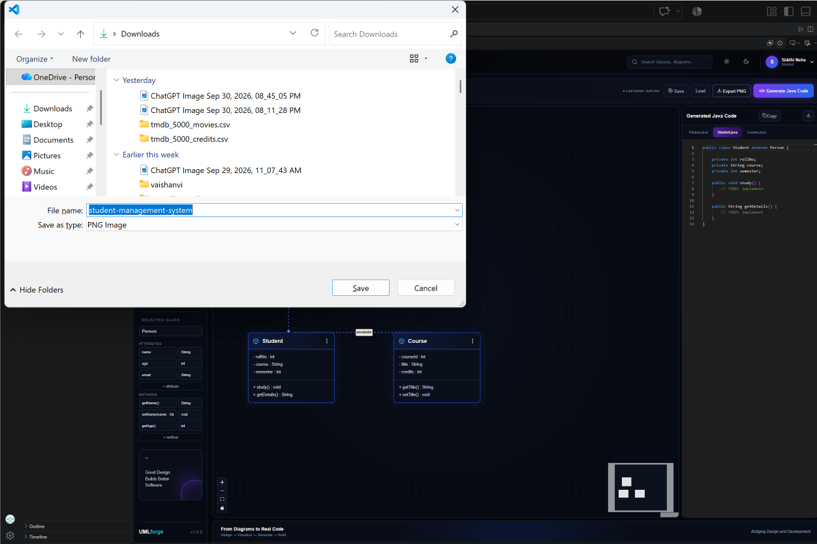

# UMLforge

UMLforge is a visual UML class diagram editor built with React. Create classes, define their attributes and methods, connect them with UML relationships, and generate Java class files directly from the diagram.

## Overview



## Features

- **Visual class diagrams:** Add, select, move, and delete classes on an interactive canvas.
- **Class editor:** Set class names and edit attributes, methods, and their types.
- **UML relationships:** Connect classes using associations, inheritance, aggregation, or composition. Select an existing connection to change its relationship type.
- **Java generation:** Generate a Java file for each class. Inheritance relationships are reflected in the generated class declaration.
- **Code tools:** Preview generated Java, copy it to the clipboard, or download the active `.java` file.
- **Save and load:** Save the current project to browser local storage and load it again from the same browser.
- **Diagram export:** Export the diagram canvas as a PNG image.
- **Undo and redo:** Reverse or restore recent diagram edits.

## Screenshots

| Diagram editor | Editor tools |
| --- | --- |
|  |  |

| Generated Java | Save controls |
| --- | --- |
|  |  |

| Export diagram |
| --- |
|  |

## Getting started

### Prerequisites

- Node.js (a version supported by Vite 8)
- npm

### Install dependencies

```bash
npm install
```

### Start the development server

```bash
npm run dev
```

Open the local address printed in the terminal to use UMLforge.

## How to use

1. Click **Add Class** to create a class on the canvas.
2. Select a class and use the **Selected Class** fields in the sidebar to edit its name, attributes, and methods.
3. Choose a relationship type in the sidebar, then drag from one class to another to connect them.
4. Select a connection and choose another relationship type to change it.
5. View the generated Java in the code panel. Select a class tab to switch files, then use **Copy** or **Download** as needed.
6. Use **Save** and **Load** to store and restore the project in this browser, or **Export PNG** to download an image of the diagram.

## Available scripts

| Command | Description |
| --- | --- |
| `npm run dev` | Start the Vite development server |
| `npm run build` | Build the application for production in `dist/` |
| `npm run preview` | Preview the production build locally |
| `npm run lint` | Run Oxlint |

## Tech stack

- [React](https://react.dev/) — user interface
- [Vite](https://vite.dev/) — development server and build tool
- [XYFlow](https://xyflow.com/) — interactive node-and-edge diagram canvas
- [Monaco Editor](https://microsoft.github.io/monaco-editor/) — Java code preview
- [Lucide](https://lucide.dev/) — interface icons
- [html-to-image](https://github.com/bubkoo/html-to-image) — PNG diagram export

## Project structure

```text
src/
  components/
    ClassNode.jsx       UML class node
    CodePanel.jsx       Generated Java preview and download controls
    DiagramCanvas.jsx   Interactive diagram and sample diagram data
    Navbar.jsx          Application navigation
    Sidebar.jsx         Diagram tools and class editor
  ustils/
    codeGenerator.js    Java source generation
  App.jsx               Application state and workspace layout
  App.css               Application styles
  index.css             Global styles
screenshorts/           README screenshots
```
