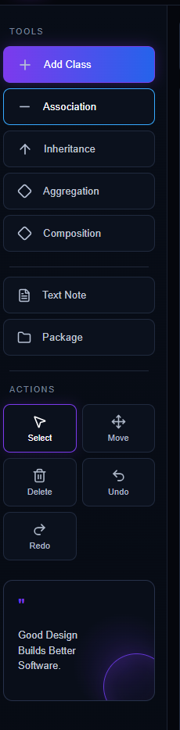

# UMLforge

UMLforge is a browser-based UML class diagram editor. Design class relationships visually, edit class details, and generate Java source code from your diagram.

## Screenshots

### Diagram editor


### Diagram tools



### Generated Java code


### Save a project


### Export a diagram


## Features

- Add and edit UML classes, attributes, and methods.
- Create associations, inheritance, aggregation, and composition relationships by connecting classes.
- Move classes around the canvas and undo or redo edits.
- Generate Java code for each class, then copy or download a `.java` file.
- Save a project in browser storage and load it again in the same browser.
- Export the diagram canvas as a PNG image.

## Getting started

### Requirements

- Node.js and npm

### Install and run

```bash
npm install
npm run dev
```

Open the local URL printed by Vite in your browser.

## Available commands

| Command | Description |
| --- | --- |
| `npm run dev` | Start the development server |
| `npm run build` | Create a production build in `dist/` |
| `npm run preview` | Preview the production build locally |
| `npm run lint` | Run Oxlint |

## Built with

- React
- Vite
- [XYFlow](https://xyflow.com/) for the interactive diagram canvas
- Monaco Editor for the generated Java code panel
- Lucide React for icons
